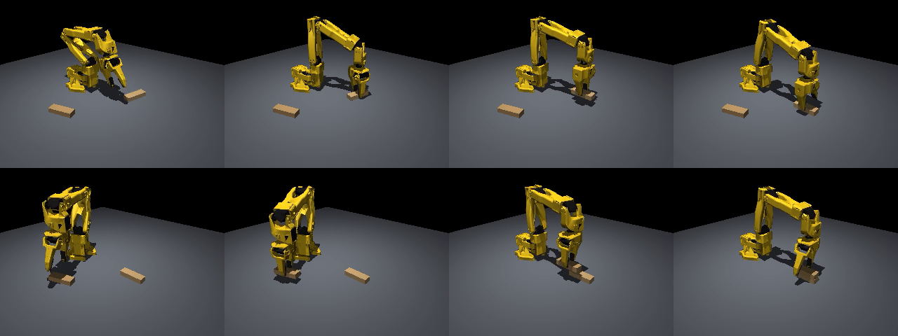

# so101-block-stacking

LeRobot SO-101 アームでジェンガのブロックを積み上げるタスクの MuJoCo シミュレータです。
Docker コンテナ上で動き、スクリプトによる自動デモから LeRobot 形式（LeRobotDataset v3）のデータセットを作成できます。



- 2 段積みの自動デモ成功率: 100 / 100
- デモデータセット: 2 段積み 100 エピソード（31,982 フレーム、30fps）

## 使い方

Docker（GPU を使う場合は NVIDIA Container Toolkit / Docker Desktop の GPU 対応）が必要です。

```bash
docker compose build                                            # イメージの作成（初回 15〜20 分）
docker compose run --rm sim python scripts/check_env.py         # 環境チェック
docker compose run --rm sim bash scripts/fetch_so101.sh         # SO-101 モデルの取得
docker compose run --rm sim python scripts/make_lowpoly.py      # 描画用メッシュの軽量化
docker compose run --rm sim python scripts/run_scripted.py --n-blocks 2 --episodes 100   # 自動デモの成功率
docker compose run --rm sim python scripts/record_demos.py --n-blocks 2 --episodes 100   # データセット作成
docker compose run --rm sim python scripts/inspect_dataset.py --repo-id local/so101_jenga_stack2
```

Gymnasium 環境の ID は `so101_stack/StackBlocks-v0` です。

## 構成

| パス | 内容 |
|---|---|
| `so101_stack/envs/` | シーンの組み立てと Gymnasium 環境 |
| `so101_stack/controllers/ik.py` | 逆運動学 |
| `so101_stack/scripted/stack_policy.py` | 自動デモ用のスクリプトポリシー |
| `scripts/` | 環境チェック、デモ実行、データセット作成などのスクリプト |
| `docker/`、`docker-compose.yml` | コンテナ環境 |
| `doc/` | 計画（plan.md）、セットアップ手順（setup.md）、報告書（report.md） |
| `report/` | 説明資料（HTML） |

## 謝辞

ロボットモデルは [TheRobotStudio/SO-ARM100](https://github.com/TheRobotStudio/SO-ARM100) の SO-101 MuJoCo モデルを使用しています（`scripts/fetch_so101.sh` で取得）。
