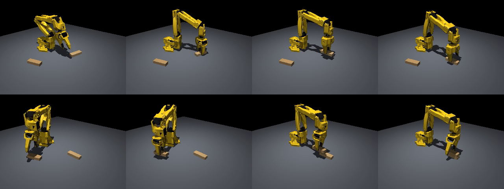
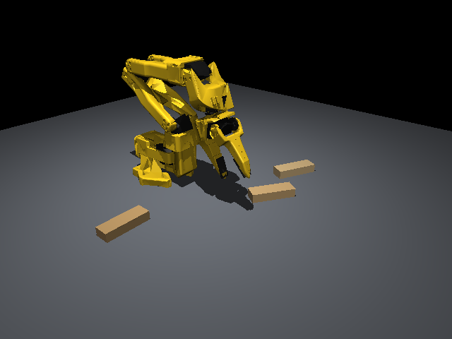
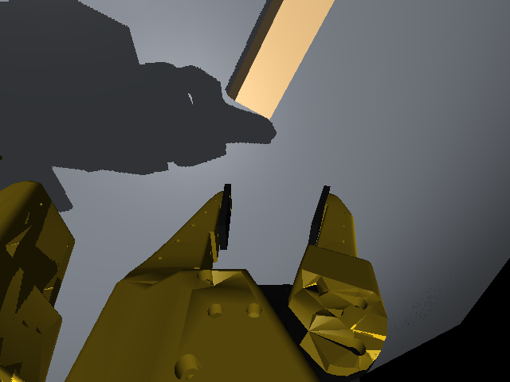
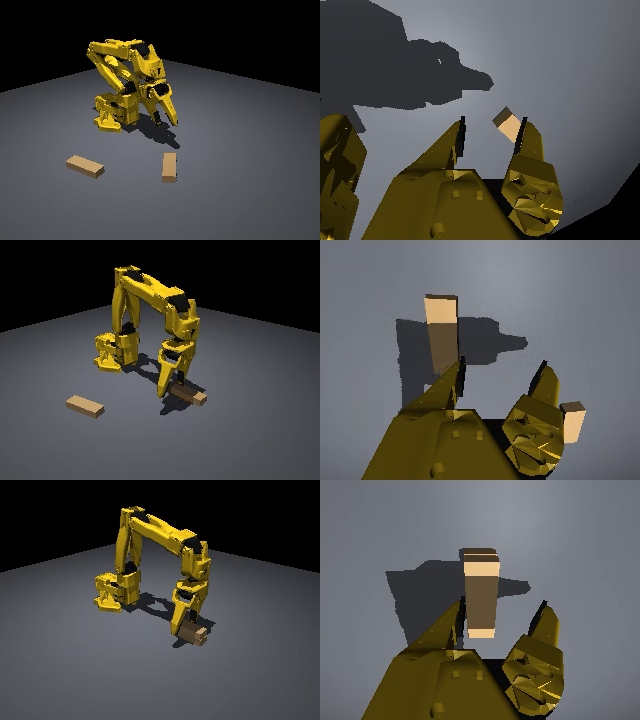

# SO-101 ジェンガ積み上げシミュレータ 構築報告書

- 作成日: 2026-11-02
- 対象: LeRobot SO-101 アームで積み木（ジェンガのブロック）を積み上げるタスクのシミュレータ環境
- 今回の範囲: **2 段積み**まで（シミュレータ構築 → 自動デモ生成 → LeRobot 形式のデモデータセット作成）

---

## 1. 概要

SO-101 アームがジェンガのブロックを積み上げるタスクを、物理シミュレータ MuJoCo 上に構築した。
環境は Docker コンテナで再現でき、スクリプトによる自動デモで LeRobot 形式の学習用データセットを作成できる。

| 項目 | 結果 |
|---|---|
| シミュレータ | MuJoCo 3.17 + Gymnasium 環境（観測・行動は実機 LeRobot と同じ単位） |
| 実行環境 | Docker（Ubuntu 24.04 / Python 3.12 / LeRobot 0.6.1 / PyTorch 2.11 + CUDA） |
| 自動デモの成功率（2 段積み） | **100%**（100 / 100 エピソード） |
| 作成したデータセット | 2 段積み **100 エピソード**（31,982 フレーム、約 18 分ぶん） |
| 動画 | [videos/stack2_demo_seed0.mp4](videos/stack2_demo_seed0.mp4)、[videos/stack2_demo_seed1.mp4](videos/stack2_demo_seed1.mp4) |



*図 1: 自動デモによる 2 段積みの流れ。1 個目をタワー位置に置き、2 個目をその上に重ねる。成功と判定された時点でエピソードが終わるため、最後のコマではグリッパがタワーに重なっている（2 段に積めていることは図 3 の wrist カメラ画像で確認できる）。*

---

## 2. 実行環境

### 2.1 ホスト

| 項目 | 値 |
|---|---|
| OS | Windows 10 Home 22H2 |
| GPU | NVIDIA GeForce GTX 1070（8GB） |
| メモリ / CPU | 16GB / Core i7-7700 |
| コンテナ基盤 | Docker Desktop 29.9（WSL2、メモリ上限 12GB・6 コアに設定） |

### 2.2 コンテナ（`docker/Dockerfile`、`docker-compose.yml`）

| 項目 | 値 |
|---|---|
| ベースイメージ | `nvidia/cuda:12.6.3-base-ubuntu24.04` |
| 主なライブラリ | LeRobot 0.6.1、PyTorch 2.11.0（cu126）、MuJoCo 3.17.0、Gymnasium 1.4 |
| GPU | コンテナから利用可能（PyTorch の学習で使用） |
| 描画 | CPU のソフトウェア描画（Mesa llvmpipe）※ 3.3 節 |

LeRobot 0.6 系が Python 3.12 以上を必要とするため、当初計画の Ubuntu 22.04 ではなく 24.04 を採用した。

---

## 3. シミュレータの構成

### 3.1 ロボットモデル

- TheRobotStudio/SO-ARM100 公式の SO-101 MuJoCo モデル（commit a758567）を使用
- 関節は 5 軸 + グリッパ。関節のゼロ点は実機の LeRobot と同じ「可動範囲の中央」
- 静止時の関節の追従誤差は 0.03° 以下（[videos/joint_sweep.mp4](videos/joint_sweep.mp4)）

### 3.2 シーン

| 要素 | 内容 |
|---|---|
| ブロック | ジェンガのサイズ（7.5 × 2.5 × 1.5cm、15g、木目調）。平らに寝かせ、ランダムな位置・向きで配置 |
| 積み方 | 同じ向きで 1 列に重ねる。幅 2.5cm の方向を挟んで掴む |
| タワーの位置 | ロボットの正面、ベースから 25cm |
| 摩擦 | 木どうし 0.5、木とテーブル 0.6、グリッパの指先 1.5 |
| カメラ | front（右前方の斜め上）と wrist（公式モデルのリストカメラと同じ位置）、各 640×480 |
| 制御周期 | 30Hz（実機の記録周期と同じ）。物理計算は 600Hz |

| front カメラ | wrist カメラ |
|---|---|
|  |  |

*図 2: リセット直後のカメラ画像。*

### 3.3 工夫した点

1. **指先の当たり判定**: 公式モデルのままでは、グリッパの指の形状が凸形状として扱われ、指の間の隙間が埋まってしまう。
   指の内側に箱形の当たり判定（パッド）を追加し、ブロックとの接触はパッドだけで行うようにした。
2. **接触の硬さ**: MuJoCo の既定の接触はやわらかく、グリッパを押し付けると 2cm 以上めり込んだ。
   テーブル・ブロック・パッドの接触を硬くし、最大のめり込みを約 6mm に抑えた。
3. **描画の高速化**: WSL2 上の Docker では NVIDIA の OpenGL が使えず、描画は CPU になる。
   ロボットの見た目用のメッシュを間引き（32 万 → 9.4 万ポリゴン）、影とアンチエイリアスの設定を軽くして、
   640×480 で **4 fps → 約 15 fps** に改善した。GPU で描画する方法（WSL の d3d12 ドライバ）は、
   NVIDIA ドライバ内部でクラッシュしたため見送った。

### 3.4 観測・行動・成功判定

| 項目 | 内容 |
|---|---|
| 観測 | 関節角 6 次元（腕は度数、グリッパは 0=閉〜100=開）+ カメラ画像 2 枚 |
| 行動 | 関節の目標角 6 次元（観測と同じ単位。実機 SO-101 と同じ） |
| 成功判定 | 目標段数に達し、グリッパが触れておらず、ブロックが 0.5 秒静止 |
| Gym ID | `so101_stack/StackBlocks-v0` |

---

## 4. 自動デモ（スクリプトポリシー）

シミュレーション内のブロックの位置を使い、逆運動学で軌道を作って動かすプログラムを作成した。

1. ブロックの真上から近づき、下ろして掴む（掴めなかったら最大 3 回やり直す）
2. 持ち上げてタワーの横に寄り、真上から下ろして放す
3. 1 個目はタワー位置に置き、2 個目以降はその上に重ねる

| 段数 | 成功率 |
|---|---|
| **2 段** | **100 / 100** |
| 3 段（参考） | 98 / 100 |
| 4 段（参考） | 20 / 20 |

※ 成功率は `run_scripted.py` での値。データセット収集（別の乱数シード）では 101 回中 1 回失敗した。

ブロックを掴む位置は、ブロック中心からジョーが開く方向に 8mm ずらしている。
SO-101 は片側の指だけが動くため、ずらさないと固定側の指がブロックに乗り上げる。

---

## 5. デモデータセット

| 項目 | 値 |
|---|---|
| 名前（repo_id） | `local/so101_jenga_stack2` |
| 保存場所 | Docker ボリューム `so101-data` の `data/so101_jenga_stack2` |
| エピソード数 | 100（成功したエピソードのみ保存。101 回試行し、失敗 1 件を破棄） |
| フレーム数 | 31,982（30fps、1 エピソード平均 10.7 秒） |
| 収集時間 | 約 65 分（1 エピソードあたり約 39 秒） |
| タスク文 | "Stack 2 Jenga blocks into a single tower." |

| キー | 形 | 内容 |
|---|---|---|
| `observation.state` | (6,) | 関節角（`shoulder_pan.pos` など、実機 LeRobot と同じ名前） |
| `observation.images.front` | (480, 640, 3) | front カメラの動画 |
| `observation.images.wrist` | (480, 640, 3) | wrist カメラの動画 |
| `action` | (6,) | 関節の目標角 |

形式は LeRobot の学習スクリプト（`lerobot-train`）でそのまま読み込める LeRobotDataset v3。



*図 3: データセットから読み込んだエピソード 0 の先頭・中間・末尾（左: front、右: wrist）。*

---

## 6. 課題と今後

| 課題 | 内容 | 対応案 |
|---|---|---|
| 3 段以上 | 自動デモは 4 段まで成功する。5 段は経路の計画が止まって 0/20 だったが、届く範囲で近づいて置く `--best-effort` で 18/20 になった。6 段は真下向きの姿勢では届かず 0/10 | グリッパを傾けて置く。傾けるとブロックも傾くため、ブロックの向きをそろえてから傾けて掴み直す動作を追加する。タワーをベースに近づける |
| 模倣学習 | 未実施（計画の Phase 4） | 作成したデータセットで ACT を学習し、シミュレータで成功率を評価する |
| 描画速度 | CPU 描画のため、データ収集に 1 エピソード約 40 秒かかる | NVIDIA ドライバ更新後に GPU 描画を再検討する |
| 実機との差 | 見た目・摩擦・モーター特性は実機と完全には一致しない | 色・照明・摩擦などをランダムに変えて学習する（ドメインランダム化） |

---

## 7. 再現手順

プロジェクトのフォルダで実行する（詳細は [setup.md](setup.md)）。

```powershell
docker compose build                                              # イメージの作成（初回 15〜20 分）
docker compose run --rm sim python scripts/check_env.py           # 環境チェック
docker compose run --rm sim bash scripts/fetch_so101.sh           # SO-101 モデルの取得
docker compose run --rm sim python scripts/make_lowpoly.py        # 描画用メッシュの軽量化
docker compose run --rm sim python scripts/run_scripted.py --n-blocks 2 --episodes 100   # 自動デモの成功率
docker compose run --rm sim python scripts/record_demos.py --n-blocks 2 --episodes 100   # データセット作成
docker compose run --rm sim python scripts/inspect_dataset.py --repo-id local/so101_jenga_stack2
```

## 付録: 主なファイル

| ファイル | 内容 |
|---|---|
| `so101_stack/envs/scene.py` | シーン（ロボット・テーブル・ブロック・カメラ）の組み立て |
| `so101_stack/envs/stack_env.py` | Gymnasium 環境 |
| `so101_stack/controllers/ik.py` | 逆運動学 |
| `so101_stack/scripted/stack_policy.py` | 自動デモ用のスクリプトポリシー |
| `scripts/record_demos.py` | デモを LeRobotDataset として保存 |
| `doc/plan.md` | 計画と各フェーズの詳細な結果 |
